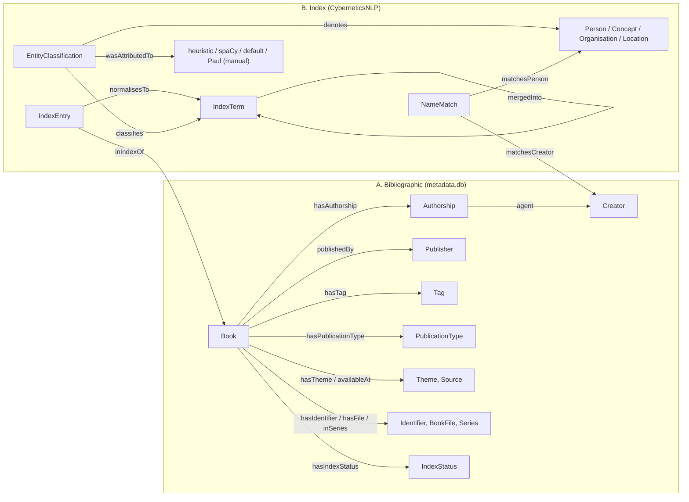

# Cybernetics Bookshelf Ontology - design note (20 October 2026)

*Changes since the 19 Oct note: publisher blurbs removed from the graph; uuid stability tested against the live Calibre library (§"Book identity"); the namespace is deliberately left undecided.*

## Purpose and scope

This is an RDF ontology and a generated knowledge graph for the Cybernetics Bookshelf corpus. It has two layers. The **bibliographic layer** takes the Calibre relational schema (`metadata.db`) as its starting point. The **index layer** covers the back-of-book indexes extracted by CyberneticsNLP, starting with the four entity kinds: person, concept, organisation and location. Version 0.1.0 covers the ontology (`02 Ontology/cybonto.ttl`), SHACL shapes (`cybonto-shapes.ttl`), the population script (`_code/build_rdf.py`), a validator (`_code/validate_rdf.py`) and six example queries (`02 Ontology/queries/`). Topics, chapters, keyphrases and co-occurrence edges are out of scope for this version.

All index-derived classifications are provisional, in line with the CyberneticsNLP standing principle. The graph records judgements together with their provenance; it does not certify anything.

## Sources

The inputs are a frozen snapshot, `00 Inputs/snapshot 2026-10-19/`: `metadata.db`, `index_terms.json`, `index_vocab.json` and `entity_types_cache.json`. They were copied from the local copy of the repo (state of 20 Sep 2026) while the sshfs mount was stale. On 19 Oct their sha256 hashes were confirmed **identical to the live repo**. They correspond to the 20 September growth run (755 Calibre books; the canonical run analysed 575). Checksums are in `MANIFEST.md` and in each build report.

## Model



The index layer has three levels, kept apart on purpose. An **IndexEntry** is a heading as printed in one book's index: evidence. An **IndexTerm** is the corpus-level heading, keyed on the lowercased form that `index_vocab.json` and `entity_types_cache.json` share. An **Entity** is what the term is judged to denote. The link from term to entity is a reified **EntityClassification**. It carries the method (`prov:wasAttributedTo`), the confidence, the spaCy label and any note, because it is a judgement made on decontextualised strings (the principle of context). "University of California" can be a publisher credit or a subject, and the classification layer is where that uncertainty lives. Entity kinds and publication types are **not declared disjoint**, which keeps inclusion semantics open for multi-kind terms.

Alignment to standard vocabularies is by `rdfs:subClassOf`/`rdfs:subPropertyOf` only. For example, `cyb:Book ⊑ bibo:Book`, `cyb:Person ⊑ foaf:Person`, `cyb:Concept ⊑ skos:Concept`, `cyb:publishedBy ⊑ dcterms:publisher` and `cyb:EntityClassification ⊑ prov:Entity`. The cyb: terms can therefore be narrowed later without breaking the alignment. `owl:equivalentClass` was avoided because Calibre's categories do not match the standard ones exactly: a Calibre "author" can be an editor or a corporation, so `cyb:Creator` is only a `foaf:Agent`.

## Mapping from the Calibre schema

| Calibre table / column | Ontology |
|---|---|
| `books` | `cyb:Book` (title, sort title, author sort, `dcterms:issued` as gYear, added, modified, cover, library path, calibreId, calibreUuid) |
| `authors`, `books_authors_link` | `cyb:Creator`; `cyb:Authorship` with `cyb:position` (link-row order); plus `dcterms:creator` shortcut |
| `publishers`, `books_publishers_link` | `cyb:Publisher`, `cyb:publishedBy` |
| `tags`, `books_tags_link` | `cyb:Tag` (SKOS), `cyb:hasTag` |
| `series`, `books_series_link`, `series_index` | `cyb:Series`, `cyb:inSeries`, `cyb:seriesIndex` |
| `languages`, `books_languages_link` | `dcterms:language` → id.loc.gov ISO 639-2 IRIs |
| `ratings`, `books_pages_link` | `cyb:rating`, `cyb:pageCount` |
| `comments` (publisher blurbs) | **not included** (Paul, 20 Oct 2026); `--include-descriptions` adds them for local use only |
| `identifiers` | `cyb:Identifier` (scheme + value); `bibo:isbn`, `bibo:doi` shortcuts |
| `data` | `cyb:BookFile` (format, file name, size) |
| custom "URL" / "Available at" / "Publication Type" / "Theme" | `cyb:sourceUrl` / `cyb:Source` / `cyb:PublicationType` (split on commas) / `cyb:Theme` |
| `library_id` | `cyb:CalibreLibrary` |
| not modelled | annotations*, feeds, conversion_options, preferences, last_read_positions, books_plugin_data, *_dirtied, "Source Link" (a composite of URL and Available at) |

## Design decisions worth checking

**IRIs come from the Calibre uuid, not the id** (tested 20 Oct; see §"Book identity" below). Creators, publishers, tags and terms get name-based slugs; any colliding names get a hash suffix, so no name silently takes another's IRI.

**Custom columns are bound by name, not number.** The July reconstruction swapped columns 4 and 5.

**Publication date is reduced to the year.** Calibre stores a full timestamp, but only the year is meaningful. The sentinel `0101-…` (undefined) is dropped; 1 book has it.

**The language codes are emitted, but not trusted.** CyberneticsNLP has shown Calibre `lang_code` to be unreliable (id 2138 is tagged `eng` but is French).

**Shortcuts are materialised for querying without a reasoner:** `dcterms:creator`, `cyb:possiblyDenotes` (term → entity, at any confidence) and `cyb:mergedInto`. The term-to-book shortcut `cyb:indexedIn` is declared as a property chain but not materialised, which saves 154k triples. Queries use `^cyb:normalisesTo/cyb:inIndexOf` instead.

**09b's term merges are recorded, not applied.** `cyb:mergedByInitials` (219: "Wiener, N." → "Wiener, Norbert") and `cyb:mergedByAccent` (67) link variant terms to canonical ones, replicating `src/09b_build_index_analysis.py`. That script does not persist its rules, so the replication is verified against its output: every variant is absent from `index_analysis.json`, and the counts reconcile. Each term keeps its own entity; the merges are pipeline decisions, not identity assertions.

**Creator ↔ person candidates.** 53 `cyb:NameMatch` nodes link a Calibre creator to an index person where `author_sort` equals the index heading, e.g. Norbert Wiener the author and "Wiener, Norbert" the indexed subject. These are candidates, not `owl:sameAs`.

**The namespace is a placeholder, deliberately undecided** (Paul, 20 Oct). `https://w3id.org/cybernetic-bookshelf/` resolves to nothing; registering it on w3id.org is one option. Changing it means editing `BASE` in the script and the prefix in the ontology together.

## Book identity: what the uuid test showed (20 Oct 2026)

The test compared the live Calibre library (`~/Desktop/Cybernetic-Bookshelf/`, `metadata.db` of 14 Oct) with each book folder's `metadata.opf`. An OPF records the uuid and id as they were when it was last written, so an untouched OPF is a witness to an earlier state. A further comparison was made against `book_styles.json` (17 Apr, old ids and titles) and the 20 Sep snapshot.

*The July rebuild preserved uuids.* 537 of the 756 OPFs were last written before July, and all agree with the current database on both uuid and id. 190 more books have rewritten OPFs but the same id as in April. A re-add would have minted a new id, so their uuids are inferred unchanged; this is inference, not verification. 29 books have no April record: new since April, or retitled, like 207 (formerly 2075). No book changed id by title match. So the "ids reassigned" description in KI-13 applies to very few books.

*Removing and re-adding a book breaks both identifiers.* After the 20 Sep snapshot, 9 books added in late August were removed and re-added. They kept their titles and "date added", but received new ids *and* new uuids. Calibre also **reuses ids**: 2828, 2829, 2831, 2832 and 2834 now belong to different books than on 20 Sep. One genuinely new book was added (2846).

*Consequences.* A uuid is never reused, so uuid IRIs fail safe: a re-add leaves a dangling IRI rather than a wrong one, whereas an id can silently point at another book. Re-adds need reconciliation between snapshots: match on title and date added, and record old IRI → new IRI (e.g. `prov:wasRevisionOf`). That step is not built yet. The alternative is a content hash of the PDF as the book key, which survives re-adds of an unchanged file but needs file access at every build. Index data and metadata must come from the **same** snapshot: `index_terms.json` (20 Sep ids) joined to today's `metadata.db` would attach five books' indexes to the wrong books. The build is safe because it reads one frozen snapshot. Upstream, the CyberneticsNLP repo still holds the 20 Sep `metadata.db`; its next run must regenerate every id-keyed artefact from one export, or persisted id-keyed files such as `book_styles.json` will misattach to reused ids.

## Counts (build 2026-10-20)

The build has 755 books, 779 creators (1,035 authorships), 316 publishers, 1,227 tags, 1,683 identifiers and 928 files; no publisher blurbs. Publication types by book (non-disjoint): monograph 576, anthology 113, textbook 33, collected works 27, proceedings 13, journal special issue 11, reference 7, catalog 3. There are 128,108 index terms and 154,568 index entries across 742 books with an index record (283 ok, 237 truncated, 15 garbled, 207 no index; 13 books have no record, the same number as KI-14's books without a PDF text row; identity of the two sets not checked). The 5,351 classifications yield 5,053 entities: 3,359 concepts, 1,287 persons, 312 organisations and 95 locations, plus 298 suppressed terms. 163 cache entries are skipped as stale: their term no longer occurs in any index (e.g. "and cybernetics"). Every node in `entity_network.json` (1,657) has a classification in the cache, so the graph covers the network's entity set. Total: about 1.36M triples. Full figures are in `03 Outputs/build report 2026-10-20.md`.

## Validation

Every cyb: term used in the data is declared in the ontology. The data conforms to the SHACL shapes, and a negative test (deliberately broken nodes) raises the expected 6 violations. In two random samples of 40 books and 40 index entries each (seeds 99 and 7 on 19 Oct; seed 20 on the 20 Oct build), every book's title, authors and author order, and every entry's book and term key, matched what was re-derived directly from `metadata.db` and `index_terms.json`. The six example queries and their results are in `03 Outputs/query results 2026-10-19.md`. Finally, the top persons by book count reproduce the pipeline's figures: "Wiener, Norbert" appears in 129 books, and 156 once "Wiener, N." is folded in, which equals `index_analysis.json`.

## Upstream issues found along the way (not fixed — CyberneticsNLP repo)

1. **`src/train_monograph_classifier.py:99` hard-codes `PUBLICATION_TYPE_COL = 5`.** Since the July reconstruction, column 5 is *Theme* (740 rows of "Cybernetics"), and Publication Type is column 4. Any retraining since July has trained on Theme. `00_export_calibre.py` already looks the column up by name; the classifier should do the same. The vault memory note "custom_column_5 = monograph labels" is stale for the same reason.
2. **`src/14_entity_network.py:314-327` collapses every person sharing a surname into one node.** It keeps the one in most books and drops the rest. Mary Catherine Bateson (7 books) and Julian Huxley (4) are missing from the network for this reason. 09b already merges initials safely, so this block is redundant where it is right and lossy where it is wrong.
3. **The accent merge in `src/09b_build_index_analysis.py:242-251` reads `n_books`, but `index_vocab.json` only has `count`.** Both sides score 0, so the accented form always becomes canonical: 14 of 67 merges point to the rarer form, e.g. `system` (68 books) → `systém` (1). Some merges are also not accent variants but different words in another language (`regulation`/`régulation`, `are`/`aré`). The canonical vocabulary therefore labels "system" as "systém".
4. **09b does not persist its merge rules**, so any consumer has to re-implement them, as this project does. Writing `json/index_merge_rules.json` would remove the duplication.

## Limitations

Page locators and sub-entry hierarchy are not retained by `09_extract_index.py`, so an IndexEntry cannot say where in the book a heading points. Identity across terms is unresolved: "Wiener, Norbert" and "Wiener, N." are two Person entities joined only through `mergedInto`. There is no Wikidata reconciliation yet, because that pass in CyberneticsNLP is incomplete. Expert publication-type labels are attributed to Paul at the scheme level, not per assertion.

## Possible next steps

The next steps, in rough order of value: (1) your review of the model; (2) snapshot-to-snapshot reconciliation of re-added books; (3) reconcile persons, organisations and locations against Wikidata (`skos:exactMatch`, kept as classifications with provenance); (4) persist locators and sub-entries upstream in 09; (5) add a PROV run layer and the LDA topic layer, keyed to equivalence classes; (6) load into a triple store (Oxigraph or GraphDB) for the CyberneticsAR consumer.

## How to run

From the project root, with rdflib installed (`pip install rdflib pyshacl`):

```
python3 "_code/build_rdf.py" --snapshot "snapshot 2026-10-19" --tag 2026-10-20
python3 "_code/validate_rdf.py" --snapshot "snapshot 2026-10-19" --tag 2026-10-20
```

To refresh: copy the four inputs from the repo into a new `00 Inputs/snapshot <date>/`, add a MANIFEST, and run with a new tag. The build takes about 2 minutes and validation about 3.
